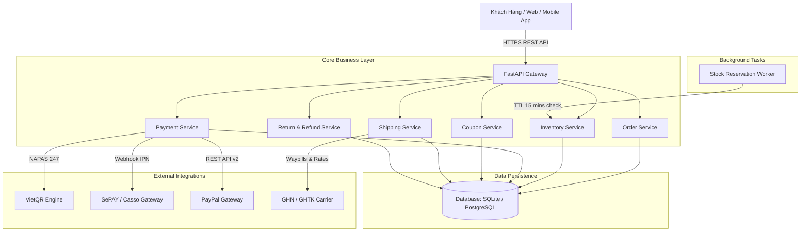
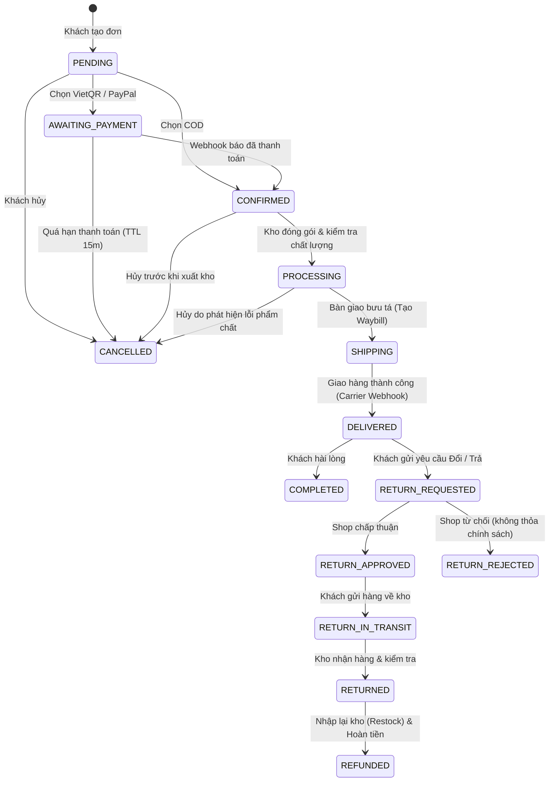
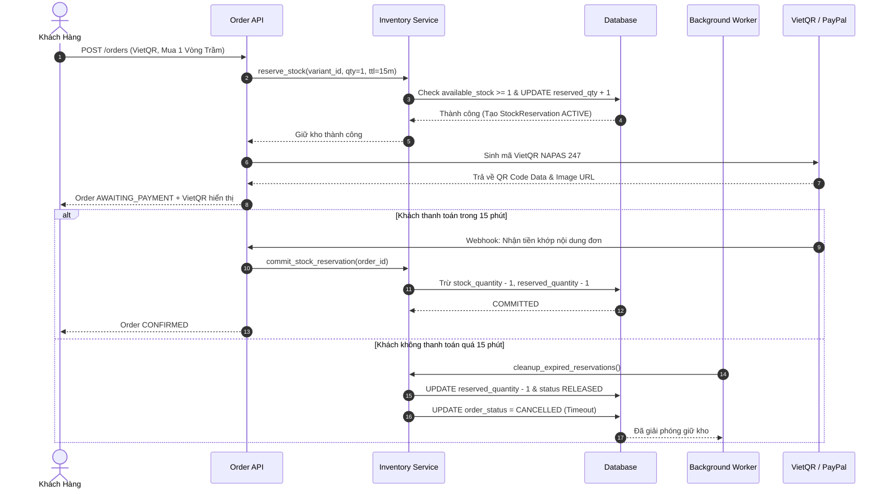

# Kiến Trúc Hệ Thống & Nghiệp Vụ Backend (Zen Agarwood OMS)
## Dự án: Quản lý Đơn hàng Trực tuyến cho Kinh doanh Trầm Hương & Dụng Cụ Thiền Định (Tĩnh Tâm Các - Trầm Hương Thiền An)

---

## 1. Tổng Quan Kiến Trúc (Architecture Overview)

Hệ thống được xây dựng theo tiêu chuẩn **Clean Architecture** và **Domain-Driven Design (DDD)**, phân tách rõ ràng giữa các tầng:
- **Presentation / API Layer (`app/api/v1/`)**: RESTful API endpoints, request validation qua Pydantic v2 schemas, phân nhóm tài liệu Swagger/OpenAPI.
- **Service / Business Logic Layer (`app/services/`)**: Xử lý toàn bộ logic nghiệp vụ cốt lõi: Checkout, Giữ tồn kho (Stock Reservation), Xác thực Coupon, Thanh toán đa kênh, Giao vận, Đổi trả & Hoàn tiền.
- **Integration Layer (`app/integrations/`)**: Tích hợp các cổng thanh toán và hãng giao vận bên thứ ba:
  - **VietQR (NAPAS 247)**: Sinh mã QR chuyển khoản ngân hàng động và xử lý Webhook SePAY/Casso.
  - **PayPal REST API v2**: Tạo đơn, link thanh toán quốc tế và capture/refund.
  - **GHN / GHTK Carrier Adapters**: Tính cước vận chuyển theo khu vực & trọng lượng gói hàng, sinh mã vận đơn Waybill và đồng bộ Webhook lộ trình.
- **Data Access Layer (`app/models/`, `app/core/database.py`)**: SQLAlchemy ORM 2.0, quản lý giao dịch ACID, row-locking chống xung đột đồng thời, hỗ trợ cả SQLite (cho dev/test tức thì) và PostgreSQL/MySQL.
- **Background Worker (`app/core/scheduler.py`)**: Tác vụ nền chạy định kỳ dọn dẹp các phiên giữ hàng hết hạn TTL (15 phút), giải phóng tồn kho khả dụng và hủy đơn quá hạn thanh toán.

---

## 2. Máy Trạng Thái Đơn Hàng (Order State Machine)

Vòng đời đơn hàng được kiểm soát chặt chẽ thông qua bảng chuyển đổi trạng thái hợp lệ (`ALLOWED_STATE_TRANSITIONS`). Mọi hành vi chuyển trạng thái bất hợp pháp (ví dụ: đơn hàng đã giao thành công mà bấm hủy) đều bị chặn lại và trả về lỗi `INVALID_STATUS_TRANSITION`.

---

## 3. Quản Lý Tồn Kho & Giữ Hàng (Stock Reservation & Concurrency)

### 3.1. Vấn đề Oversell & Race Condition
Đối với các mặt hàng thủ công quý hiếm như **Chuỗi vòng trầm hương chìm nước 108 hạt** hoặc **Chuông xoay Full Moon 7 kim loại từ Nepal**, số lượng tồn kho rất có hạn. Nếu 2 khách hàng cùng bấm thanh toán trực tuyến cùng lúc mà không có cơ chế giữ kho, hệ thống sẽ rơi vào tình trạng **Bán vượt tồn kho (Overselling)**.

### 3.2. Cơ chế Giải Quyết:
1. **Khóa giữ hàng nguyên tử (Atomic Reservation)**:
   - Khi khách hàng tạo đơn với phương thức VietQR hoặc PayPal, hệ thống thực hiện kiểm tra:
     `available_quantity = stock_quantity - reserved_quantity >= requested_quantity`.
   - Nếu thỏa mãn, tăng `reserved_quantity += quantity` và tạo bản ghi `StockReservation` với thời gian hết hạn `expires_at = now + 15 phút`.
   - Đảm bảo tính toán trong một SQLAlchemy ACID transaction với row locking (`with_for_update()`).
2. **Xác nhận trừ kho (Commit Reservation)**:
   - Khi nhận được Webhook thanh toán thành công:
     `stock_quantity -= reserved_qty`, `reserved_quantity -= reserved_qty`, trạng thái chuyển thành `COMMITTED`.
3. **Nhả kho (Release Reservation)**:
   - Nếu đơn hàng bị hủy hoặc khách không thanh toán:
     `reserved_quantity -= reserved_qty`, trạng thái chuyển thành `RELEASED`.
4. **Tác vụ nền tự động dọn dẹp (Background Worker)**:
   - Worker chạy định kỳ mỗi 60 giây, tự động tìm các reservation quá 15 phút chưa thanh toán, nhả kho khả dụng và chuyển đơn hàng sang `CANCELLED` (Lý do: Timeout).

---

## 4. Cổng Thanh Toán & Webhook (Payment Gateways)

### 4.1. COD (Thanh toán khi nhận hàng):
- Thích hợp với khách hàng mua nhang nụ hoặc dụng cụ xông trầm muốn nhận hàng kiểm tra trước.
- Đơn hàng chuyển sang `CONFIRMED` ngay khi tạo đơn, commit trừ kho lập tức. Số tiền thu hộ (`cod_amount`) được chuyển tiếp sang phiếu vận đơn của bên giao vận.

### 4.2. VietQR (NAPAS 247) & SePAY Webhook:
- Chuẩn VietQR tĩnh/động theo chuẩn ngân hàng nhà nước và NAPAS.
- Tự động sinh nội dung chuyển khoản chuẩn theo mã đơn hàng: `DH<order_code>`.
- Trả về cả **Quick Link VietQR.io** và **Ảnh Base64 PNG inline render bằng thư viện offline**, khách hàng chỉ cần quét bằng app ngân hàng (Vietcombank, MB, Techcombank, VPBank, v.v.).
- **Idempotency & Checksum**: Webhook SePAY/Ngân hàng được xác thực qua Authorization Bearer Token. Nếu một Webhook bị gửi lặp lại (duplicate request), hệ thống nhận diện giao dịch đã `PAID` và trả về kết quả an toàn `already_processed` mà không trừ kho 2 lần.

### 4.3. PayPal REST API v2:
- Dành cho khách kiều bào tại Mỹ, Châu Âu, Úc mua Trầm Hương cao cấp và Chuông Xoay Tây Tạng.
- Tự động quy đổi tỷ giá ngoại tệ VND -> USD theo tỷ giá cấu hình.
- Tích hợp chuẩn v2 Checkout (`POST /v2/checkout/orders` và `POST /v2/checkout/orders/{id}/capture`).
- Hỗ trợ cả **Sandbox Simulator Mode** (chạy test không cần chờ kết nối PayPal) và **Live Sandbox API**.

---

## 5. Vận Chuyển & Quản Lý Vận Đơn (Shipping & Tracking)

### 5.1. Thuật toán tính cước giao vận:
- **Chính sách Freeship**: Đơn hàng từ **500.000đ** trở lên được miễn phí vận chuyển toàn quốc.
- **Cước cơ bản**:
  - Nội thành (TP.HCM, Hà Nội, Khánh Hòa, Đà Nẵng): **25.000đ** (Giao trong 1-2 ngày).
  - Ngoại thành & Liên tỉnh: **35.000đ** (Giao trong 2-4 ngày).
- **Phụ phí cân nặng**: Đối với các dụng cụ thiền nặng (Chuông xoay 1.5kg, Lư đồng 800g, Bồ đoàn vỏ đậu 1.6kg), gói hàng trên 1000g cộng thêm 5.000đ mỗi 500g tiếp theo.

### 5.2. Quản lý Vận đơn (Waybill) & Webhook:
- Tích hợp adapter chuẩn cho các hãng giao vận (GHN - Giao Hàng Nhanh, GHTK - Giao Hàng Tiết Kiệm).
- Sinh mã vận đơn duy nhất: `GHN-VN-xxxxxx`.
- Cung cấp link in phiếu gửi hàng điện tử `label_url`.
- Webhook nhận cập nhật lộ trình: `PICKED` -> `IN_TRANSIT` -> `OUT_FOR_DELIVERY` -> `DELIVERED`.
- Khi hãng giao vận phát tín hiệu `DELIVERED`, hệ thống tự động cập nhật đơn hàng thành `DELIVERED`, và đối với đơn COD, tự động cập nhật trạng thái thanh toán sang `PAID`.

---

## 6. Đổi Trả & Hoàn Tiền (Return & Refund)

### 6.1. Quy trình tiếp nhận & thẩm định:
1. **Khách hàng gửi yêu cầu (`POST /api/v1/returns`)**:
   - Áp dụng cho đơn hàng đã `DELIVERED` hoặc `COMPLETED`.
   - Chọn lý do: `DAMAGED_IN_TRANSIT` (Vỡ nứt lư trầm gốm), `WRONG_ITEM` (Gửi nhầm size vòng), `DEFECTIVE_AROMA` (Mùi trầm không đúng phẩm chất), `NOT_AS_DESCRIBED`.
   - Đính kèm URL hình ảnh/video bằng chứng mở kiện hàng.
2. **Admin xét duyệt (`POST /api/v1/returns/{id}/review`)**:
   - Thẩm định hình ảnh: Duyệt (`APPROVED`) và cấp mã vận đơn hoàn trả hàng, hoặc Từ chối (`REJECTED`) kèm ghi chú rõ ràng.
3. **Kho nhận hàng & Hoàn tiền (`POST /api/v1/returns/{id}/refund`)**:
   - Kiểm tra sản phẩm và tự động **Nhập kho trở lại (Restock items)**: `variant.stock_quantity += quantity`.
   - Kích hoạt hoàn tiền:
     - Đơn thanh toán qua PayPal: Tự động gọi **PayPal Refund API** hoàn trả vào tài khoản PayPal của khách.
     - Đơn COD hoặc VietQR: Ghi nhận lệnh ủy nhiệm chi chuyển khoản ngân hàng kèm số tài khoản của khách.
   - Chuyển trạng thái đơn hàng sang `REFUNDED`.
